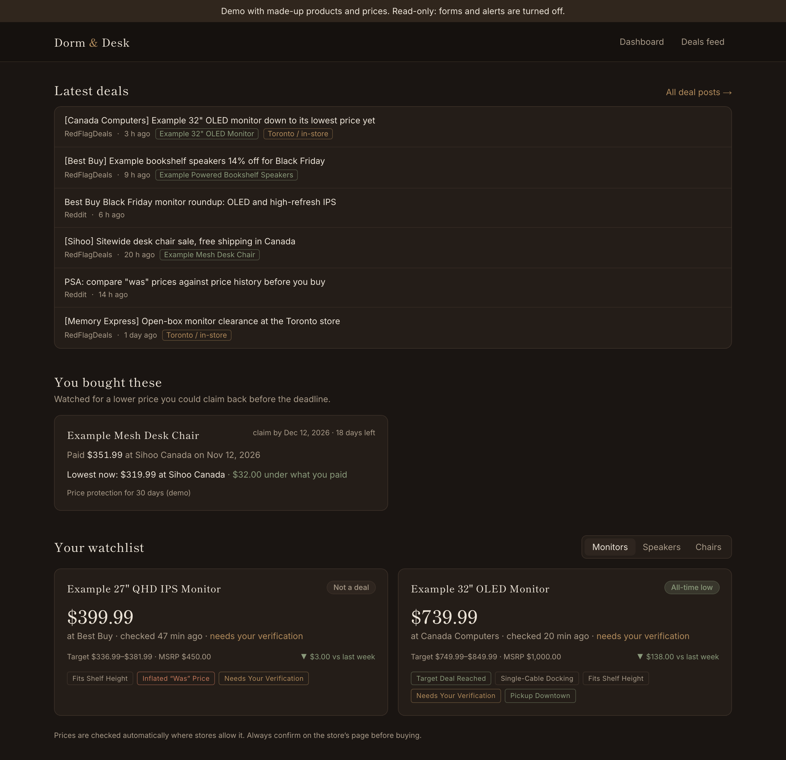
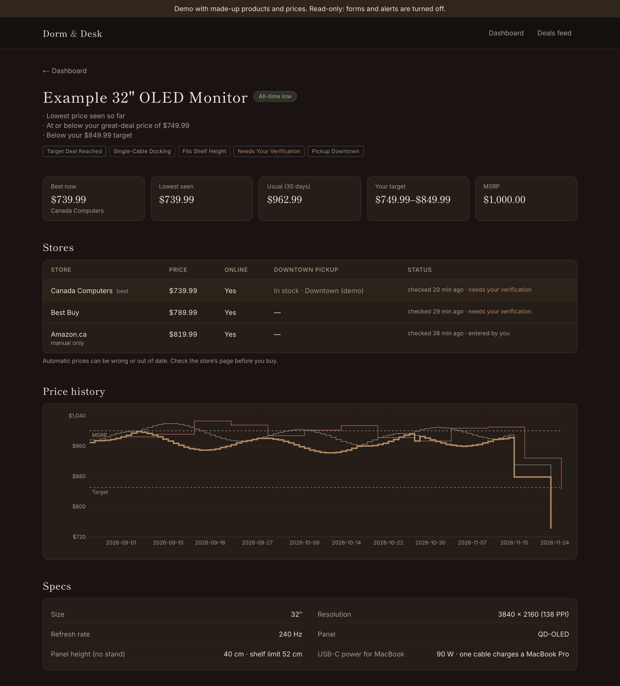
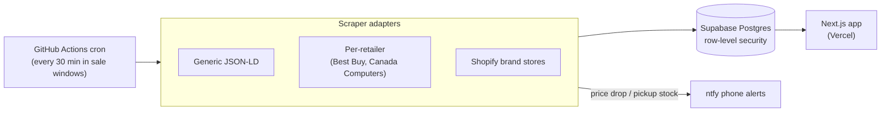

# Dorm & Desk Tracker

[](https://github.com/ciro-wang/dorm-desk-tracker/actions/workflows/ci.yml)

**One page that shows the real best price for the things I'm buying this Black Friday, across Canadian retailers, and pings my phone when it's actually a deal.**

Buying a monitor and speakers during Black Friday meant dozens of open retailer tabs and guessing whether each "sale" was real, since a "was $1,299" label often just reflects a price nobody paid. This app checks every store on a schedule, keeps its own price history, and judges each price against that history instead of the retailer's "was" price. It is a private, single-owner app built for one student's shopping list and designed to cost nothing to run.

| Deals feed | Product page with price history |
|---|---|
|  |  |

<sub>Screenshots are from the read-only demo mode (below), which uses made-up products and prices, not a real watchlist.</sub>

## Features

- **Best price across stores.** Each product links to listings at many retailers, and every check records each store's price and stock. The lowest valid price wins; marketplace sellers are excluded unless marked trusted.
- **Price history.** A chart of the best price over time, with a line per store, plus the all-time low and the typical price.
- **Deal verdict.** Each price gets a verdict (all-time low, great, at target, fair, not a deal) from our own history, MSRP and my target. Inflated "was" prices are flagged.
- **In-store pickup.** Shows same-day pickup stock at downtown Toronto stores, so a slightly pricier listing available today isn't hidden.
- **Phone alerts.** Push notifications through [ntfy](https://ntfy.sh) when a product drops below target, drops further, or gains pickup stock.
- **Manual price entry.** When a store blocks scraping, I can type in the price I'm seeing. Manual entries are labelled and still count in the history.
- Also: a Canadian deals feed (RedFlagDeals and subreddits, ranked by relevance to the watchlist), USD listings converted to CAD at the Bank of Canada rate, and tracking of things already bought.

## How it works



1. A scheduled GitHub Actions job runs every 30 minutes during Black Friday and Boxing Week, and about every 3 hours otherwise.
2. Each listing goes to an adapter: a generic one that reads schema.org JSON-LD, dedicated ones for retailers with their own APIs or page layouts, and one for Shopify stores. Blocked pages are detected and marked as blocked, never parsed as a price. Pages that need JavaScript are loaded in a headless Playwright browser.
3. Results go into Supabase Postgres. Row-level security is on for every table, so only the owner's session can read the data.
4. The Next.js app reads the data, computes the best price and verdict, and renders the feed and product pages.
5. When an alert-worthy event happens, the job sends one ntfy notification for it.

## Design principles

- **Never show a confident wrong number.** Every scraped price shows its source and when it was checked. Stale or failed checks are shown as stale, not as a price.
- **Judge deals against our own history, not the "was" price.** A sale only counts if it beats what we've actually observed.
- **One alert per event.** Alerts fire when something changes (a new low, new pickup stock), not on every check.
- **Free to run.** Vercel's free tier, Supabase's free tier, GitHub Actions and ntfy. No paid services.

## Tech stack

| Area | Tools |
|---|---|
| App | Next.js 16 (App Router), React 19, TypeScript, Tailwind CSS 4, Base UI / shadcn, Recharts |
| Data | Supabase (Postgres, Auth, row-level security), Zod validation |
| Scraping | Cheerio, Axios, Playwright, rss-parser |
| Jobs and alerts | GitHub Actions cron, ntfy |
| Quality | Vitest, ESLint, gitleaks |

## Testing

```bash
npm test            # 196 tests in 37 files (Vitest)
npm run lint
npm run typecheck
```

Scraper tests run against saved HTML and JSON fixtures from real retailer pages, including blocked and bot-check pages. Other tests cover pricing and verdict rules, alert decisions, the job scheduler, input validation, security headers, that every database table has row-level security enabled, and that demo mode cannot write, reach the cron routes or start next to real credentials.

CI ([`ci.yml`](.github/workflows/ci.yml)) runs lint, typecheck and the full test suite on every push and pull request, plus a [gitleaks](https://github.com/gitleaks/gitleaks) secret scan over the whole history.

## Limitations

Many Canadian retailers block automated traffic, especially from cloud servers. Those stores fall back to manual price entry. Status as of October 2026:

| Store | Automatic check | Notes |
|---|---|---|
| Canada Computers | Yes | Product page JSON-LD, plus per-store stock for pickup |
| Best Buy | Yes | HTML is blocked, but its JSON product and availability endpoints work. Pickup is unverified. |
| Shopify brand stores | Yes | Added after this survey (e.g. Sihoo) |
| Amazon.ca | No (manual) | No JSON-LD; bot defences expected from cloud IPs |
| Dell | No (manual) | No JSON-LD price |
| Newegg | No (manual) | Blocked (403 / bot wall) |
| Memory Express | No (manual) | Blocked (403) |
| Crutchfield | No (manual) | Blocked (403 / bot wall) |
| Visions | No (manual) | Blocked without a browser; no JSON-LD |
| Fluance, Bay Bloor Radio | No (manual) | Need specific listing URLs |

Other limits: it is single-user by design (one password, no accounts), and scraped prices are best-effort, which is why every price shows when it was checked.

## Demo mode

The real app is private and password-protected, so there is a read-only demo mode for reviewers. Setting `DEMO_MODE=1` makes the app:

- serve made-up products, prices and deal posts built from `seed.example.json` (all links go to example.com), with no login;
- reject every write: non-GET requests get a 405, which also blocks Server Actions, and the demo data client throws on any insert, update or delete;
- return 404 for every `/api` route, including the cron and alert jobs;
- refuse to start if any Supabase, ntfy or cron secret is set, so it can't be turned on by mistake in the real deploy.

Try it on a fresh clone (no `.env.local`):

```bash
npm install
DEMO_MODE=1 npm run dev
```

## Local setup

```bash
npm install
cp .env.example .env.local   # fill in values; never commit this file
npm run dev
```

Tests: `npm test` · Types: `npm run typecheck` · Lint: `npm run lint`

`seed.example.json` shows the seed format with demo products. Personal data (watchlist, targets, pickup stores) lives only in the database and in the git-ignored `seed.local.json`. Never commit it.
